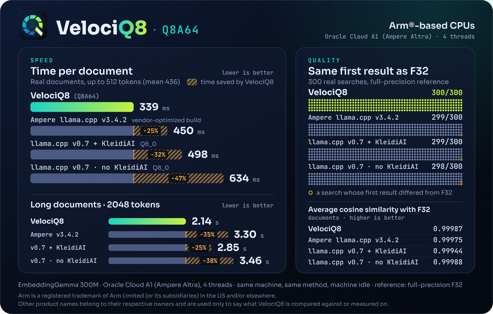
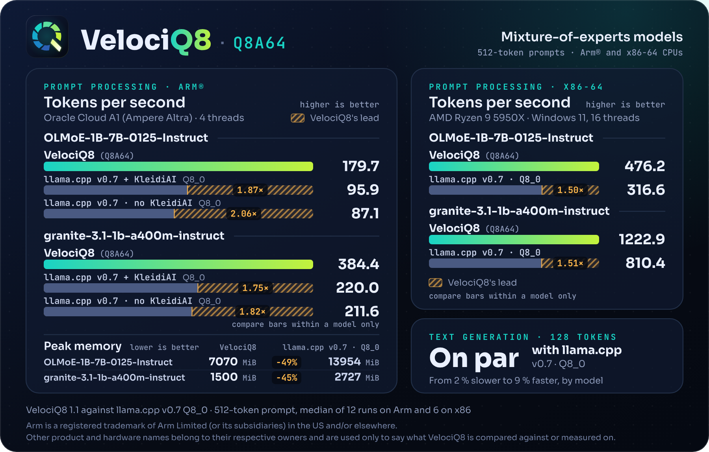

<p align="center">
  <picture>
    <source media="(prefers-color-scheme: dark)" srcset="assets/logo-wordmark-dark.svg">
    
  </picture>
</p>

VelociQ8 is a build of [llama.cpp](https://github.com/ggml-org/llama.cpp) that runs 8-bit models faster on CPUs. It adds Q8A64, an 8-bit weight format with its own CPU kernels for Arm (dotprod) and x86-64 (AVX2 + FMA). The tools are the usual `llama-server`, `llama-cli`, `llama-embedding` and `llama-bench`, with the same options and the same HTTP API. Since 1.1, `llama-quantize` writes Q8A64 files.

The main target is embeddings on CPU servers. It also runs LLMs, including mixture-of-experts models.

<p align="center"></p>

## Features

- Same tools, options and HTTP API as llama.cpp, including the OpenAI-compatible endpoints of `llama-server`. Clients that already talk to llama.cpp work without changes.
- No conversion step. Point the tools at a BF16, F16 or F32 GGUF and the weights are converted to Q8A64 while the model loads. Pre-converted Q8A64 files load directly, and since 1.1 you can write your own with `llama-quantize`.
- Embedding models, dense LLMs and, since 1.1, mixture-of-experts LLMs. Hybrid architectures such as granite-4.0-h, LFM2.5 and, since 1.5, LFM3 work too.
- Kernels for Arm (dotprod) and x86-64 (AVX2 + FMA, and since 1.4 AVX-VNNI and AVX-512 VNNI). The `linux-arm64-multi` archive picks the best build for the CPU at startup, and since 1.1 it uses the i8mm matrix instructions on CPUs that have them.
- Less memory on Arm: VelociQ8 runs the weights straight from a Q8A64 file, while llama.cpp keeps a second, repacked copy of Q8_0 weights. With OLMoE-1B-7B the peak is 6.9 GiB against 13.6 GiB.
- Ollama: a portable Ollama 0.40.13 with VelociQ8 inside, for Linux and Windows. On x86-64 it also runs on the GPU through Vulkan (NVIDIA, AMD and Intel), and there are `-cuda` archives for NVIDIA. The Llama app for Windows works with the Windows archive.
- Portable binaries. The Linux archives need glibc 2.28 or newer (RHEL 8, Debian 10, Ubuntu 20.04 and later), and the Windows executables are static, with no DLLs.

## Results

### Embeddings

EmbeddingGemma 300M, time per document. Lower is better.

| CPU | VelociQ8 | llama.cpp v0.7.0, Q8_0 | Time saved |
|---|---|---|---|
| Oracle Cloud A1 (Ampere Altra), 4 threads, documents up to 512 tokens | 339 ms | 634 ms | 47 % |
| AMD Ryzen 9 5950X, 1 thread, 374 tokens | 909 ms | 1209 ms | 25 % |
| AMD Ryzen 9 5950X, 16 threads, 374 tokens | 178 ms | 240 ms | 26 % |

In 300 real searches on Arm, VelociQ8 returned the same first result as the full-precision F32 model in all 300.

### LLM prompt processing

512-token prompts, tokens per second against llama.cpp v0.7.0 with Q8_0. Higher is better.

| Model | CPU | VelociQ8 | llama.cpp | Speedup |
|---|---|---|---|---|
| Llama-3.2-1B | Oracle Cloud A1, 4 threads | 232.3 | 149.3 | 1.56× |
| Llama-3.2-1B | Ryzen 9 5950X, 16 threads | 598.8 | 328.4 | 1.82× |
| granite-3.1-1b-a400m (MoE) | Oracle Cloud A1, 4 threads | 384.4 | 211.6 | 1.82× |
| granite-3.1-1b-a400m (MoE) | Ryzen 9 5950X, 16 threads | 1222.9 | 810.4 | 1.51× |
| OLMoE-1B-7B (MoE) | Oracle Cloud A1, 4 threads | 179.7 | 87.1 | 2.06× |
| OLMoE-1B-7B (MoE) | Ryzen 9 5950X, 16 threads | 476.2 | 316.6 | 1.50× |

Text generation runs at about the speed of llama.cpp on these models, from 2 % slower to 9 % faster. On Arm, llama.cpp built with KleidiAI is faster than VelociQ8 on dense LLMs (16 % on Llama-3.2-1B prompt processing), but its output drifts 10 to 18 times further from full precision (KL divergence, measured on llama.cpp v0.6).

<p align="center"></p>

### Accuracy

KL divergence from the full-precision model on wikitext-2. Lower is better.

| Model | VelociQ8 | llama.cpp, Q8_0 |
|---|---|---|
| Llama-3.2-1B | 0.000916 | 0.000950 |
| gemma-3-1b | 0.001889 | 0.003248 |
| Qwen3-1.7B | 0.002523 | 0.003306 |
| granite-4.0-h-350m | 0.003113 | 0.006265 |
| granite-3.1-1b-a400m (MoE) | 0.00242 | 0.00363 |
| OLMoE-1B-7B (MoE) | 0.00641 | 0.00748 |
| LFM2.5-1.2B | 0.001720 | 0.001772 |
| Qwen3.5-0.8B | 0.000960 | 0.001241 |
| gemma-4-E2B | 0.004768 | 0.008783 |

VelociQ8 has less divergence than Q8_0 on seven of these nine models and is level on Llama-3.2-1B and LFM2.5. The first four rows were measured against llama.cpp v0.6, the rest against v0.7.0.

The full tables, the other builds we compared against and how each number was measured are in [docs/benchmarks.md](docs/benchmarks.md) and [docs/quality.md](docs/quality.md).

## Download

Each release is built on one llama.cpp release. VelociQ8 1.0 and 1.1 are based on llama.cpp v0.7.0, 1.2 on b11738, 1.3 on b11803, 1.4 on b11845 and 1.5 on b11963.

| File | For |
|---|---|
| `velociq8-1.5-linux-arm64.tar.gz` | Arm servers with dotprod: Ampere Altra, AWS Graviton2 and later, Neoverse N1 and later |
| `velociq8-1.5-linux-arm64-multi.tar.gz` | Any 64-bit Arm CPU. It picks the best kernels for the CPU at startup, including i8mm |
| `velociq8-1.5-linux-x64.tar.gz` | x86-64 with AVX2 and FMA (Intel Haswell, AMD Zen and later) |
| `velociq8-1.5-windows-x64.zip` | Windows on the same x86-64 CPUs (tested on Windows 11) |

For Ollama 0.40.13 there are `velociq8-1.5-ollama-0.40.13-linux-arm64.tar.gz`, `-linux-x64.tar.gz` and `-windows-x64.zip`; the x86-64 ones also use the GPU through Vulkan. For NVIDIA GPUs there are `-linux-x64-cuda.tar.gz` and `-windows-x64-cuda.zip`, about 0.7-0.8 GB each. See [Ollama](docs/usage.md#ollama). The Llama app for Windows works with the Windows archive; see [Llama app for Windows](docs/usage.md#llama-app-for-windows).

Older releases have the same names with their version.

Check the download against `SHA256SUMS` from the same release.

There is also a Docker image for Linux on Arm and x86-64, [`ghcr.io/dhaern/velociq8`](https://github.com/dhaern/VelociQ8/pkgs/container/velociq8), with an example setup for HTTPS. See [Docker](docs/usage.md#docker) and [HTTPS](docs/usage.md#https).

## Models

Ready-made Q8A64 files are on Hugging Face: see the [VelociQ8 profile](https://huggingface.co/VelociQ8), the [embedding models](https://huggingface.co/collections/VelociQ8/embeddings-6ad81d5d6f476c0c66ccf753) and the [text models](https://huggingface.co/collections/VelociQ8/text-models-6ae3a448a70c7ba93ce2c594). Each model card gives the prompts, the license of the original model and how the file was checked. These files load only in VelociQ8. Any other model in BF16, F16 or F32 GGUF runs as it is, or can be converted with `llama-quantize`.

## Quick start

Download a release archive and a ready-made Q8A64 model from Hugging Face, then start an embeddings server:

```sh
tar xf velociq8-1.5-linux-arm64.tar.gz
cd velociq8-1.5-linux-arm64
curl -LO https://huggingface.co/VelociQ8/embeddinggemma-2-Q8A64-GGUF/resolve/main/embeddinggemma-2-Q8A64.gguf
./llama-server -m embeddinggemma-2-Q8A64.gguf --embedding -t 4 -b 2048 -ub 2048 --port 8080
```

```sh
curl -s http://127.0.0.1:8080/v1/embeddings \
  -H 'Content-Type: application/json' \
  -d '{"input": "task: search result | query: Does VelociQ8 run on the CPU?"}'
```

Any BF16, F16 or F32 GGUF works too: VelociQ8 converts it while loading.

An LLM runs the same way, with the OpenAI-compatible chat endpoint:

```sh
./llama-server -m granite-3.1-1b-a400m-instruct-f16.gguf -t 4 --port 8080
```

```sh
curl -s http://127.0.0.1:8080/v1/chat/completions \
  -H 'Content-Type: application/json' \
  -d '{"messages": [{"role": "user", "content": "What is the capital of France?"}]}'
```

See [docs/usage.md](docs/usage.md) for pre-converted Q8A64 files, converting your own, memory locking and the options that matter.

## Documentation

- [Usage](docs/usage.md): loading models, Q8A64 files and the relevant options.
- [Compatibility](docs/compatibility.md): CPUs, operating systems, validated models and known limitations.
- [Benchmarks](docs/benchmarks.md): all measurements and how they were taken.
- [Quality](docs/quality.md): accuracy against full precision, for embeddings and LLMs.
- [Models](https://huggingface.co/VelociQ8): ready-made Q8A64 files on Hugging Face.
- [Changelog](CHANGELOG.md).

## License

VelociQ8 is proprietary software, free to use under the [VelociQ8 Software License Agreement](LICENSE). You may run it for personal or commercial work. You may not redistribute, modify, decompile or reverse engineer it, except where the law expressly allows it.

The release archives also contain llama.cpp, which is MIT licensed, and the third-party components it links. Those keep their own licenses, which are in the `licenses/` folder of each archive. Q8A64 model files keep the license of the original model.

Arm is a registered trademark of Arm Limited (or its subsidiaries) in the US and/or elsewhere. Other product names belong to their owners and are used only to say what VelociQ8 is compared against or measured on.
