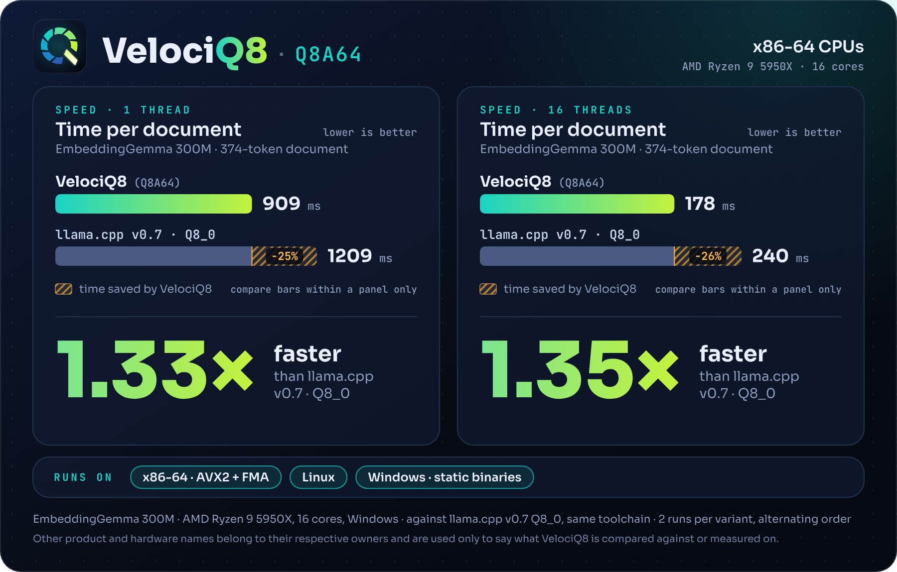

# Benchmarks

All numbers were measured in October 2026. Each table says which builds were compared, on which machine and with which model. The embedding and dense LLM tables were measured with VelociQ8 1.0; VelociQ8 1.1 gives the same output on those models. The mixture-of-experts tables are for VelociQ8 1.1.

## Arm: Oracle Cloud A1 (Ampere Altra)

EmbeddingGemma 300M, 4 threads, `llama-server`. The corpus has 300 real documents, cut to at most 512 tokens (165 to 512 tokens, mean 436), plus 300 short queries. Every build gets exactly the same requests. Every build ran two full rounds, interleaved with the others, on an idle machine. The tables give the mean of the two rounds.

VelociQ8 ran from the `velociq8-1.0-linux-arm64` archive and loaded a Q8A64 file. The llama.cpp builds loaded the Q8_0 GGUF. Ampere's build loaded its own Q8R16 file.

### Time per request

Lower is better. "Saved" is the share of time VelociQ8 saves against that row.

| Build | Document (up to 512 tokens) | Saved | 1024 tokens | 2048 tokens | Saved (2048) | Short query, median |
|---|---|---|---|---|---|---|
| **VelociQ8 1.0** | **338.9 ms** | | **887.2 ms** | **2137.8 ms** | | **25.6 ms** |
| Ampere llama.cpp v3.4.2 | 450.2 ms | 25 % | 1226.2 ms | 3301.3 ms | 35 % | 28.7 ms |
| llama.cpp v0.7.0 + KleidiAI, Q8_0 | 497.7 ms | 32 % | 1169.8 ms | 2845.1 ms | 25 % | 27.3 ms |
| llama.cpp v0.7.0, Q8_0 | 633.8 ms | 47 % | 1466.2 ms | 3455.7 ms | 38 % | 37.1 ms |

The accuracy of the same runs is in [quality.md](quality.md).

### LLM

Llama-3.2-1B, 4 threads, `llama-bench` with 3 repetitions per run and flash attention on. Each build ran two rounds, interleaved, in the same session as the embedding runs. The table gives the median of the six repetitions of each build. Q8A64 file against the Q8_0 GGUF. Higher is better.

| Test | VelociQ8 1.0 | llama.cpp v0.7.0 + KleidiAI, Q8_0 | llama.cpp v0.7.0, Q8_0 |
|---|---|---|---|
| Prompt processing, 512 tokens | 232.3 tok/s | 268.7 tok/s | 149.3 tok/s |
| Text generation, 128 tokens | 26.7 tok/s | 30.0 tok/s | 27.1 tok/s |

On Arm LLMs, the KleidiAI build is faster than VelociQ8: 16 % on prompt processing and 12 % on text generation. It gets there by giving up accuracy: its divergence from F32, measured on llama.cpp v0.6, is 10 to 18 times higher (see [quality.md](quality.md#llms)). Against llama.cpp without KleidiAI, VelociQ8 processes prompts 1.56 times faster and generates text at about the same speed (the 1.4 % gap is within the spread between runs).

### Mixture-of-experts LLMs

VelociQ8 1.1, 4 threads, `llama-bench` with 3 repetitions per run and flash attention on. VelociQ8 converted the F16 model while loading; the llama.cpp builds loaded the Q8_0 GGUF. Higher is better.

granite-3.1-1b-a400m-instruct. Median of 12 repetitions per build, in two interleaved rounds.

| Test | VelociQ8 1.1 | llama.cpp v0.7.0 + KleidiAI, Q8_0 | llama.cpp v0.7.0, Q8_0 |
|---|---|---|---|
| Prompt processing, 512 tokens | 384.4 tok/s | 220.0 tok/s | 211.6 tok/s |
| Text generation, 128 tokens | 38.3 tok/s | 35.6 tok/s | 35.0 tok/s |

OLMoE-1B-7B-0125-Instruct. Median of 12 repetitions per build, from two interleaved rounds. The machine has 23 GB of RAM. Earlier rounds, where swapping slowed down every build, were discarded. Swap stayed in use during these two rounds as well (6.4 to 11 GB), and some text-generation repetitions were disturbed; the median limits their effect. VelociQ8 loaded a pre-converted Q8A64 file here. Converting from F16 gave 181.4 and 17.1 tok/s in the first of those rounds.

| Test | VelociQ8 1.1 | llama.cpp v0.7.0 + KleidiAI, Q8_0 | llama.cpp v0.7.0, Q8_0 |
|---|---|---|---|
| Prompt processing, 512 tokens | 179.7 tok/s | 95.9 tok/s | 87.1 tok/s |
| Text generation, 128 tokens | 17.7 tok/s | 17.6 tok/s | 17.5 tok/s |

Prompt processing is 1.75 to 2.06 times faster than llama.cpp. Text generation is 8 to 9 % faster on granite and level on OLMoE.

### Memory with mixture-of-experts models

Peak memory (resident set) during the same `llama-bench` runs, loading a pre-converted Q8A64 file against the Q8_0 GGUF.

| Model | Q8A64 file | VelociQ8 1.1 peak | Q8_0 file | llama.cpp v0.7.0 peak |
|---|---|---|---|---|
| granite-3.1-1b-a400m | 1413 MiB | 1500 MiB | 1356 MiB | 2727 MiB |
| OLMoE-1B-7B | 6908 MiB | 7070 MiB | 7019 MiB | 13954 MiB |

On Arm, llama.cpp repacks Q8_0 weights into a second copy, so it holds about twice the file size. VelociQ8 runs the packed weights straight from the file.

### LFM3

VelociQ8 1.5 against llama.cpp b11963, 4 threads, `llama-bench` with 3 repetitions per run and flash attention on, two interleaved rounds. Median of the six repetitions of each build. VelociQ8 loaded the published Q8A64 files and llama.cpp the Q8_0 files described in [quality.md](quality.md#lfm3). Tokens per second, higher is better.

| Model | Prompt processing, 512 tokens: VelociQ8 / Q8_0 | Text generation, 128 tokens: VelociQ8 / Q8_0 |
|---|---|---|
| LFM3-1.7B | 168.9 / 103.2 | 17.8 / 18.6 |
| LFM3-1.7B-Base | 168.3 / 103.1 | 18.5 / 18.5 |
| LFM3-VL-2B | 166.3 / 104.1 | 18.5 / 18.9 |

Prompt processing is 1.64 times faster than llama.cpp on LFM3-1.7B, 1.63 times on the base model and 1.60 times on LFM3-VL-2B. Text generation is level on the base model, and llama.cpp is 2 % faster on LFM3-VL-2B and 4 % on LFM3-1.7B. Two of VelociQ8's text-generation repetitions on LFM3-1.7B were disturbed (9.8 and 4.5 tok/s); without them its median is 18.2 tok/s.

## x86-64: AMD Ryzen 9 5950X

Windows 11, 16 cores. Both builds come from the same llama.cpp v0.7.0 source and were compiled with the same toolchain and flags (static, x86-64-v3). The only difference is the VelociQ8 code. They ran in the order VelociQ8, llama.cpp, llama.cpp, VelociQ8, and the tables give the mean of the two runs of each.

### Embeddings

EmbeddingGemma 300M, one document of 374 tokens. VelociQ8 loaded a Q8A64 file and llama.cpp the Q8_0 GGUF. Lower is better.

| Threads | VelociQ8 1.0 | llama.cpp v0.7.0, Q8_0 | Speedup | Saved |
|---|---|---|---|---|
| 1 | 908.9 ms | 1209.3 ms | 1.33× | 25 % |
| 16 | 178.1 ms | 239.6 ms | 1.35× | 26 % |

### LLM

Llama-3.2-1B, `llama-bench` with 3 repetitions per run and flash attention on. Q8A64 file against the Q8_0 GGUF. Higher is better.

| Test | Threads | VelociQ8 1.0 | llama.cpp v0.7.0, Q8_0 | Ratio |
|---|---|---|---|---|
| Prompt processing, 512 tokens | 16 | 598.8 tok/s | 328.4 tok/s | 1.82× |
| Text generation, 128 tokens | 16 | 32.30 tok/s | 32.12 tok/s | 1.01× |
| Text generation, 128 tokens | 8 | 32.82 tok/s | 32.57 tok/s | 1.01× |

Text generation is a tie: the two runs of each build overlap. Both formats read about the same number of bytes of weights per token.

VelociQ8 1.1 runs Llama-3.2-1B at the same speed as 1.0 here: in a separate session, both converting the BF16 model while loading, the medians differed by less than 1 % in all three tests.

### Mixture-of-experts LLMs

VelociQ8 1.1, `llama-bench` with 3 repetitions per run and flash attention on. VelociQ8 converted the F16 model while loading; llama.cpp loaded the Q8_0 GGUF. Median of the six repetitions of each build. Higher is better.

| Model | Test | Threads | VelociQ8 1.1 | llama.cpp v0.7.0, Q8_0 | Ratio |
|---|---|---|---|---|---|
| granite-3.1-1b-a400m-instruct | Prompt processing, 512 tokens | 16 | 1222.9 tok/s | 810.4 tok/s | 1.51× |
| granite-3.1-1b-a400m-instruct | Text generation, 128 tokens | 16 | 94.6 tok/s | 96.9 tok/s | 0.98× |
| granite-3.1-1b-a400m-instruct | Text generation, 128 tokens | 8 | 96.3 tok/s | 96.2 tok/s | 1.00× |
| OLMoE-1B-7B-0125-Instruct | Prompt processing, 512 tokens | 16 | 476.2 tok/s | 316.6 tok/s | 1.50× |
| OLMoE-1B-7B-0125-Instruct | Text generation, 128 tokens | 16 | 37.4 tok/s | 35.4 tok/s | 1.06× |
| OLMoE-1B-7B-0125-Instruct | Text generation, 128 tokens | 8 | 37.7 tok/s | 36.9 tok/s | 1.02× |

Prompt processing is 1.5 times faster on both models. Text generation is within a few percent either way: the first repetition of each llama.cpp run was 4 to 19 % slower than the other two, which spreads its numbers more than VelociQ8's.

## Method

- Speed is measured on an idle machine, with nothing else heavy running, except where noted below. Builds alternate within the same session, so drift in the machine affects all of them equally.
- Model loading is never part of the measured time.
- On the 4-core Arm machine, the two rounds of each build differed by 0.2 % to 1.8 % in time per document (VelociQ8: 0.7 %). Differences of that size are not reported as results.
- For LLMs on Arm, the median is used because one of VelociQ8's six text-generation repetitions was disturbed (21.6 tok/s, against 24.7 to 27.2 tok/s for the other five). The mean of all six would be 25.7 tok/s.
- The mixture-of-experts runs on Arm were taken with the machine's services stopped but an interactive session open, so some repetitions were disturbed (the slowest text-generation repetition on granite was 7.2 tok/s, for llama.cpp). The tables use the median of each build for that reason.
- The embedding corpus comes from real use and is private, so it is not published. The models are public.
